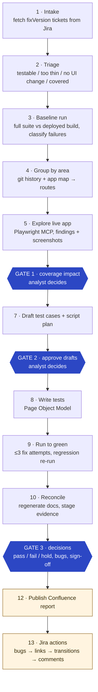
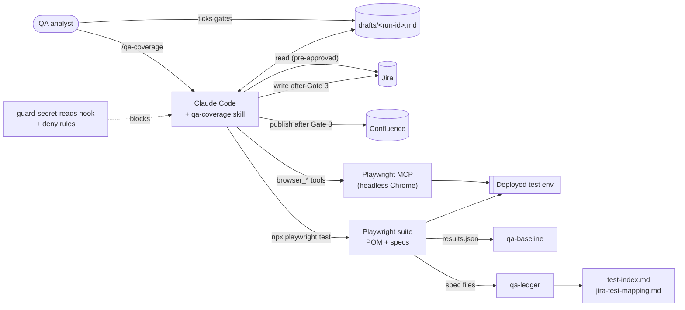

# Shipwright

**AI-assisted release QA that keeps a Playwright suite true to what actually shipped.**


Shipwright is a release-QA workflow for any web project that has a Jira board and a deployed test environment. It grew out of the process I used on the Anser project, and I rebuilt it as a kit that installs on a new project by editing a few config files. A QA analyst runs one command, and Shipwright:

- reads every ticket in a release from Jira
- runs the regression suite against the deployed build and works out which failures are intended changes and which are regressions
- explores the changed areas of the live app in a real browser
- drafts, writes and stabilises new Playwright tests
- publishes a QA coverage report to Confluence
- transitions tickets, comments with evidence and files linked bugs in Jira

**The analyst makes every judgement call at three review gates.** Nothing is written to Jira or Confluence until the analyst has approved the exact list of changes.

> The ticket says what was intended. The app says what exists. Where they disagree, the app wins, and the disagreement is reported as a finding. It is never resolved silently.

---

## Contents

1. [The problem](#the-problem)
2. [What I built](#what-i-built)
3. [How it works](#how-it-works)
4. [The hard part: intended change or regression?](#the-hard-part-intended-change-or-regression)
5. [Guardrails](#guardrails)
6. [Architecture](#architecture)
7. [Engineering highlights](#engineering-highlights)
8. [Security model](#security-model)
9. [Lessons codified from a mature suite](#lessons-codified-from-a-mature-suite)
10. [From one project to any project](#from-one-project-to-any-project)
11. [Repository layout](#repository-layout)
12. [Using it on your project](#using-it-on-your-project)
13. [Skills demonstrated](#skills-demonstrated)

**Deeper reading:**

- [docs/example-release-run.md](docs/example-release-run.md): a full release run, gate by gate
- [docs/architecture.md](docs/architecture.md): components, data flow and sequence diagrams
- [docs/design-decisions.md](docs/design-decisions.md): the key decisions, the alternatives and the trade-offs
- [docs/index.html](docs/index.html): a one-page visual case study (works with GitHub Pages)

---

## The problem

On a project that ships every sprint, the end-to-end suite drifts away from the app after every release. Each release brings three recurring problems.

**1. Red tests are ambiguous.** A failing test might mean:

- the release changed that behaviour on purpose, so the test should be updated
- the release broke it, so it's a regression and the test must not be touched
- only the markup moved, so the locator needs fixing
- the environment is flaky, for example an expired session or reseeded data

Misclassifying in one direction ships a regression to production as "the new behaviour". Misclassifying in the other wastes a developer's afternoon on a bug that isn't one.

**2. New features go untested.** Writing tests from ticket text is fast but dangerous. A ticket marked *Done* may not be deployed, and a test written from the description can read perfectly while testing nothing.

**3. The paperwork is relentless.** Each ticket needs triage, coverage tracking and test IDs. Docs must stay in sync. Each ticket needs a QA comment with evidence and a status transition. Bugs need duplicate-checking and linking, and each release needs a report and a sign-off.

AI agents can do most of this work quickly. Left unchecked, though, they "fix" tests by weakening assertions, invent acceptance criteria and write confidently to systems of record. Shipwright is built to get the speed without those failure modes.

---

## What I built

I designed the workflow and wrote everything in this repo:

| Component | What it is |
|---|---|
| **The `/qa-coverage` skill** ([SKILL.md](qa-coverage-kit/.claude/skills/qa-coverage/SKILL.md) + [7 reference files](qa-coverage-kit/.claude/skills/qa-coverage/references/)) | A 13-step, 3-gate workflow for Claude Code with 8 non-negotiable rules. The agent loads each reference file only at the step that needs it |
| **The Playwright suite scaffold** ([playwright-qa/](qa-coverage-kit/playwright-qa/)) | Config, cached authentication, a Page Object Model base, a starter smoke test, and conventions written for both humans and agents |
| **`qa-ledger`** ([qa-ledger.mjs](qa-coverage-kit/playwright-qa/scripts/utils/qa-ledger.mjs)) | A dependency-free Node tool. It validates every test ID and docstring and generates the test index, the Jira-to-test mapping and the doc summary blocks. A CI-ready `--check` mode fails on stale or malformed output |
| **`qa-baseline`** ([qa-baseline.mjs](qa-coverage-kit/playwright-qa/scripts/utils/qa-baseline.mjs)) | Turns Playwright's JSON report into a list of unexpected results, and flags known bugs whose tests now pass |
| **Secret guard** ([guard-secret-reads.mjs](qa-coverage-kit/.claude/hooks/guard-secret-reads.mjs) + [settings.json](qa-coverage-kit/.claude/settings.json)) | Permission deny rules plus a `PreToolUse` hook, so the agent can never read credential files through any tool |
| **QA knowledge base** ([QA-LESSONS.md](qa-coverage-kit/playwright-qa/QA-LESSONS.md), [KNOWN-ISSUES.md](qa-coverage-kit/playwright-qa/scripts/KNOWN-ISSUES.md)) | 17 rules learned the hard way on a live suite, each with *why* and *enforced by* |
| **The portable kit** ([SETUP.md](qa-coverage-kit/SETUP.md), [workflow.toml](qa-coverage-kit/workflow.toml)) | All project-specific values moved into one config file, with a 7-step setup guide for a new project |

---

## How it works

### Three modes

```text
/qa-coverage release "2026-09 R4"     every ticket in the Jira fixVersion (primary mode)
/qa-coverage PROJ-327                 one ticket: hotfix, re-check, or a ticket held by a blocking bug
/qa-coverage "<what I tested>"        turn a manual test session into automated coverage
```

### The release flow



### Gates are a file, not a chat

At each gate the agent writes a structured section with checkboxes into `qa-output/drafts/<run-id>.md`, posts a one-line summary, and **stops**. The analyst answers by editing the file: ticking boxes, adding notes, or rewriting a drafted test case. Then they reply "Gate 1 done". The agent re-reads the file before continuing, and **an unticked box is a question, never an approval**.

This gives the analyst a reviewable, diffable record of every decision. It also gives the agent a resume point: if a session dies mid-release, the next run offers to resume from the last gate passed.

A Gate 1 excerpt (see the [full example run](docs/example-release-run.md)):

```markdown
### Existing tests
- PROJ-210-3 — **undecided**: Orders table lost its "Status" column; PROJ-327 touched this page but doesn't mention it
  [ ] intended change (update the test)   [ ] regression (leave it, report it)      Notes:
- MAN-users-2 — **possible regression**, linked to PROJ-390 (medium): Users table no longer sorts by Role — reported, test untouched
- PROJ-180-1 — mechanics only (heading moved into a card) — locator will be fixed
```

---

## The hard part: intended change or regression?

This is where most of the value is. Every unexpected failure in the baseline run goes into exactly one class, and each class has an **evidence bar**:

| Class | Evidence required | Action |
|---|---|---|
| **Intended change** | A ticket *in this release* describes the new behaviour, **and** the live app shows exactly that | Propose updating the test at Gate 1, citing ticket + AC. Tag the test with that ticket |
| **Test mechanics** | Behaviour is unchanged. The element, text and outcome still exist, but markup or role moved | Fix the locator without approval. **What the test asserts must not change** |
| **Possible regression** | Behaviour differs and **no ticket in scope accounts for it** | **Don't touch the test.** Report it, attributed to the likely ticket through `git log` on the affected route, with a confidence level |
| **Environment** | Session expiry, fixture drift, leftover data, toolchain crash, or the suite running ahead of the deployed build | Fix the test or fixture and log an `ISS-TS-<slug>` known issue |
| **Undecided** | Evidence fits two classes | Don't guess. Present both at Gate 1 and let the analyst decide |

Two details that matter in practice:

- **"Locator not found" isn't automatically mechanics.** The agent takes a snapshot of the live page. If the thing the test looked for is still there under a different name, the failure is mechanics. If it's gone, the behaviour changed.
- **The suite can be ahead of the app.** The test branch may already carry a later ticket's update while the test environment runs an older build. Before calling anything a regression, the agent checks `git log` on the spec and page object. Without this check, a passing test can be "fixed" back to old behaviour, or a bug can be filed against working code.

Known-bug tests (`test.fail()`) are excluded from classification. **If one starts passing, that is itself a finding**: the bug looks fixed, so the agent checks the bug's Jira status and proposes removing the marker.

---

## Guardrails

These are the skill's eight non-negotiables. They exist because each one is a predictable way an agent can go wrong.

1. **Never write a test for behaviour you haven't observed in the live app.** Done in Jira does not mean deployed.
2. **Never invent or renumber acceptance criteria.** If a ticket has no usable ACs, the agent asks a question rather than guessing a test case.
3. **The how-versus-what rule.** The agent may change *how* a test finds things on its own. It may change *what* a test expects only with a ticket in scope or the analyst's approval.
4. **Never weaken an assertion to get green.** A genuine app failure is a finding.
5. **External writes happen only after Gate 3, as one approved batch.** Every Jira and Confluence write is listed with its exact content first. Write tools are also deliberately **not pre-approved**, so each one still raises a permission prompt.
6. **Credentials never enter context or files.** This is enforced by tooling, not just by instructions (see [Security model](#security-model)).
7. **Repo writes stay inside `playwright-qa/`.**
8. **Gates are hard stops.** Nothing beyond the current gate runs without the analyst's reply.

The run-to-green loop is bounded too: **at most 3 fix attempts per failing test**, then the agent stops and reports. Each failure gets a specific diagnosis:

- **Locator timeout:** a wrong selector, or content that loads late. Never fixed with a blind `waitForTimeout`.
- **Wide failures late in a long run:** session expiry.
- **Passes alone but fails in the suite:** shared state. Never fixed by adding a retry.

---

## Architecture



There are two separate browser paths, each for a different job. **Playwright MCP** explores the app interactively, so the agent sees what actually shipped. **The Playwright test runner** executes the suite. Both share one saved login (`fixtures/auth.json`), which the agent itself can never read.

Sequence diagrams and component details are in [docs/architecture.md](docs/architecture.md).

---

## Engineering highlights

### Collision-free, permanent test IDs

Tests are numbered **within the ticket that created them**, not from a global counter:

| Item | Scheme | Example |
|---|---|---|
| Test from a ticket | `<TICKET>-<n>` | `PROJ-327-1` |
| Test from manual testing | `MAN-<area>-<n>` | `MAN-period-control-1` |
| Feature / workflow | `F-<slug>` / `WF-<slug>` | `F-order-totals` |
| Test-infra issue | `ISS-TS-<slug>` | `ISS-TS-session-expiry` |
| App bug | its Jira key | `PROJ-812` |

Two analysts, or two agent runs on separate branches, can never pick the same ID, and nothing is ever renumbered. Removing a test retires its ID.

### The spec is the documentation

Every test opens with a machine-parsable docstring. It includes a plain-language `Verifies:` line for non-technical readers:

```ts
/** PROJ-327-1: Order total includes tax | PROJ-327 AC2 | Positive | High
 *  Verifies: the order detail page shows a total equal to subtotal plus tax for a taxable order. */
test('PROJ-327-1 — order total includes tax', { tag: ['@PROJ-327'] }, async ({ page }) => {
```

The ID records the originating ticket. The `@tags` record **every** ticket that later changed the test, so the Jira-to-test mapping stays accurate as behaviour evolves.

### `qa-ledger`: generated docs that can't drift

[`qa-ledger.mjs`](qa-coverage-kit/playwright-qa/scripts/utils/qa-ledger.mjs) is about 350 lines of dependency-free Node. It parses spec files **statically**, without loading the Playwright config or `.env`, so it's safe to run anywhere, including CI. It:

- validates IDs against the scheme and catches duplicates, including duplicates across automated and not-automated cases
- requires the docstring format and a `Verifies:` line on every test
- generates `test-index.md`, `jira-test-mapping.md` (with Jira links built from `workflow.toml`), and marker-delimited blocks inside `README.md` and `CLAUDE.md`
- normalises CRLF/LF before comparing and writes back in each file's own line ending, so the staleness check doesn't fail on every Windows checkout
- exposes `--write`, `--check` (exit 1 on any error or stale output), `--json`, and `--tickets KEY1,KEY2` for coverage lookups during triage

```text
$ npm run qa:ledger -- --check
qa-ledger
─────────────────────────────
Declared tests:     1 (1 active, 0 expected-fail, 0 skipped)
ID scheme:          0 ticket-scoped · 1 MAN-* · 0 not automated
Known failures:     0 → none
Errors:             0
Warnings:           0
─────────────────────────────
```

### `qa-baseline`: a regression shortlist from the JSON report

[`qa-baseline.mjs`](qa-coverage-kit/playwright-qa/scripts/utils/qa-baseline.mjs) walks Playwright's `results.json` and lists every failure and flaky pass with its test ID, location and first error line (ANSI codes stripped). It also sets `knownBugNowPassing` when a `test.fail()` test unexpectedly passes. It prints the run's start time so a stale report is obvious. This guards against a real trap: passing `--reporter=line` replaces the config's reporters, so no new JSON is written.

### Auth that never expires mid-run

[`auth.setup.ts`](qa-coverage-kit/playwright-qa/scripts/tests/auth.setup.ts) signs in once and caches the session. It reuses that session **only while it is younger than `AUTH_REUSE_MINUTES`**, a value sized as *session lifetime minus longest run*. The config's `globalTimeout` caps the run time so the two can't drift apart. Mid-run session expiry otherwise looks exactly like a wide regression.

### Built for a shared, live environment

- `workers: 1` and `fullyParallel: false`: tests never collide on data or logins.
- Records the suite creates carry a fixed name prefix and are swept **before and after** each run, so a single crashed `afterAll` can't leave orphans that block the next run.
- `BasePage.open(path, readyLocator)` waits on an element that proves the page rendered. It never uses `networkidle`, which apps with background polling never reach.

---

## Security model

The agent drives a real logged-in browser and runs shell commands, so credential safety is enforced in **two layers**:

1. **Permission deny rules** ([settings.json](qa-coverage-kit/.claude/settings.json)) block the Read tool on `scripts/.env` and `fixtures/auth.json`.
2. **A `PreToolUse` hook** ([guard-secret-reads.mjs](qa-coverage-kit/.claude/hooks/guard-secret-reads.mjs)) closes the gap a Read rule leaves open: `cat`, `type`, `Get-Content`, `cp` or `grep` through Bash or PowerShell. Its regexes match path tokens rather than substrings, so `.claude/.env` or `my-scripts/.env` don't false-positive. They also catch the bare `.env` when the command runs inside the suite folder. The design errs towards blocking: a false block costs one retry, while a leak can't be undone.

Verified behaviour:

| Command | Result |
|---|---|
| `cat playwright-qa/scripts/.env` | **blocked** (exit 2) |
| `Get-Content fixtures/auth.json` | **blocked** (exit 2) |
| `cat .claude/.env` | allowed |
| `npm test` | allowed |

Beyond credentials:

- Jira and Confluence **write** tools are deliberately left off the skill's pre-approved list.
- The agent never writes a secret into test-data docs. It records the `.env` variable name instead.
- It never fabricates domain-specific test data. It asks, or marks the case BLOCKED.

---

## Lessons codified from a mature suite

[QA-LESSONS.md](qa-coverage-kit/playwright-qa/QA-LESSONS.md) holds 17 durable rules. Each is a pattern rather than an incident report, with a **Why** and an **Enforced by** line. The agent re-reads them before writing any locator or wait. Some examples:

| Rule | The trap |
|---|---|
| `playwright-isvisible-is-one-shot` | `isVisible({ timeout })` **ignores the timeout**. Right after `goto` it reads `false` off a loading skeleton, silently inverting cleanup guards |
| `an-expected-fail-test-must-fail-for-the-right-reason` | A `test.fail()` test "passes" on *any* failure, including a broken locator, so it stays green after the bug is fixed |
| `the-suite-can-be-ahead-of-the-deployed-app` | "Fixing" a failure caused by an undeployed later ticket reverts that ticket's intended change |
| `hydration-can-wipe-early-input` | On SSR React apps, text typed right after load can be erased by hydration. It looks like "search is broken" |
| `wait-on-the-thing-that-actually-changes` | Skeleton cards count as containers. Poll for the *content*, not the list element |
| `a-cli-reporter-replaces-the-config-reporters` | `--reporter=line` silently drops the JSON report, so the baseline summary describes the previous run |
| `generated-docs-must-ignore-line-endings` | Byte-for-byte staleness checks fail on every Windows checkout with `autocrlf` |
| `prefer-behaviour-assertions-size-coverage-to-risk` | Presence checks break on cosmetic changes and rarely catch regressions. Assert values, URLs and counts |

---

## From one project to any project

The original ran on Anser and was wired into that project's routes, priority scheme, release pipeline and a companion `/bug-triage` skill. To make it reusable, I separated **workflow** from **project facts**:

| Anser version | This kit | Why |
|---|---|---|
| Called `/bug-triage` to file bugs | Files bugs itself: duplicate search, a triage table to confirm, create, link | No second skill to port |
| Legacy `TC-nnn` IDs, reserved ranges | Only `<TICKET>-<n>` and `MAN-<slug>-<n>` | A new suite has no history to carry |
| V8 code-coverage fixture + monocart reporter | Left out, portable later | Optional for a new project |
| Release tracking ticket and feature specs required | Optional, switched on in `workflow.toml` | They depended on Anser's release pipeline |
| Routes, priorities and timings in the skill text | Moved to `workflow.toml` and the suite's App map | Project values live in config |
| Python secret-guard hook (needs `uv`) | Node hook | Node is already required by Playwright |

Optional features **switch themselves off** when their config is empty. With no Confluence page configured, for example, the report stays in the draft file. With no tracking label, the release sign-off lives only in the report.

---

## Repository layout

```text
.
├── README.md                         ← you are here
├── docs/
│   ├── index.html                    one-page visual case study
│   ├── example-release-run.md        a release run, gate by gate
│   ├── architecture.md               components, data flow, sequences
│   └── design-decisions.md           decisions, alternatives, trade-offs
└── qa-coverage-kit/                  the installable kit
    ├── SETUP.md                      7-step adoption guide
    ├── workflow.toml                 all project-specific values
    ├── .mcp.json                     pinned Playwright MCP server
    ├── .claude/
    │   ├── settings.json             deny rules + hook registration
    │   ├── hooks/guard-secret-reads.mjs
    │   └── skills/qa-coverage/
    │       ├── SKILL.md              the workflow + non-negotiables
    │       └── references/           intake ×3, failure classification,
    │                                 reconcile, Jira actions, templates
    └── playwright-qa/
        ├── CLAUDE.md                 conventions + app map (for agents and humans)
        ├── QA-LESSONS.md             17 codified rules
        ├── README.md                 the analyst's guide to the process
        ├── qa-output/                generated index + mapping, hand-kept docs
        └── scripts/
            ├── playwright.config.ts
            ├── pages/                Page Object Model
            ├── tests/                auth.setup + specs by area
            └── utils/                qa-ledger, qa-baseline, auth
```

---

## Using it on your project

Prerequisites: Node 20+, Google Chrome, Claude Code, the Atlassian connector, and a QA account on the test environment.

```bash
# 1. Copy everything in qa-coverage-kit/ (except SETUP.md) into your repo root
# 2. Fill in the REQUIRED values in workflow.toml
cd playwright-qa/scripts
npm install
npx playwright install chromium
cp .env.example .env              # fill in BASE_URL, QA_EMAIL, QA_PASSWORD yourself
npm run setup                     # signs in, caches the session
npm test                          # MAN-smoke-1 should pass
npm run qa:ledger -- --check
```

Then adapt three app-specific files (`utils/auth.ts`, `pages/HomePage.ts`, and the App map in `playwright-qa/CLAUDE.md`). Restart Claude Code to load the Playwright MCP server, and start with a single ticket:

```text
/qa-coverage PROJ-123
```

The full guide is in [qa-coverage-kit/SETUP.md](qa-coverage-kit/SETUP.md).

---

## Skills demonstrated

- **Test automation:** Playwright + TypeScript, Page Object Model, auth state caching, `test.fail()`/`test.skip()` semantics, stable locator strategy, flake diagnosis
- **QA strategy:** regression vs intended-change classification, risk-sized coverage, outcome-based assertions, evidence-backed bug reports, release sign-off
- **AI agent engineering:** designing a multi-step agent workflow with human-in-the-loop gates, bounded retry loops, resumable state, least-privilege tool permissions, and tool-enforced (not prompt-enforced) safety
- **Tooling:** dependency-free Node CLIs, static parsing, generated documentation with CI staleness checks, cross-platform line-ending handling
- **Integration:** Jira (JQL, transitions, issue links, comments), Confluence publishing, Playwright MCP, git-history attribution
- **Platform thinking:** turning a project-specific tool into a configurable, documented kit that another team can adopt

---

## License

Released under the [MIT License](LICENSE). The example release run in `docs/` uses invented tickets and data.

*Built by Andrew Lawrence.*
