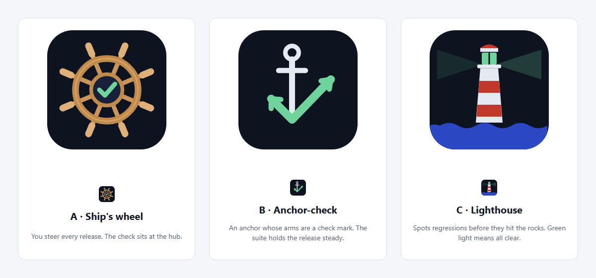
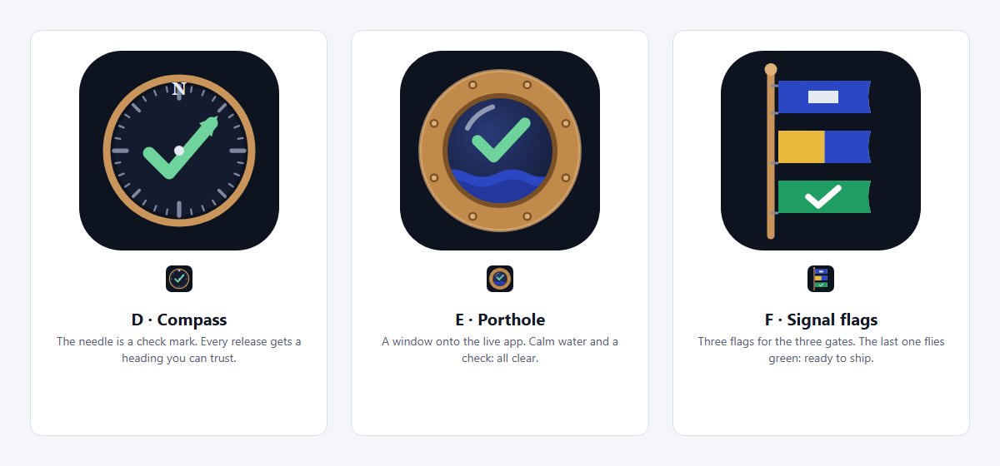
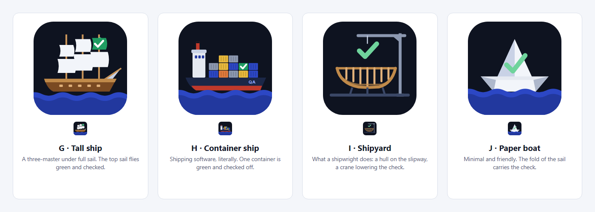
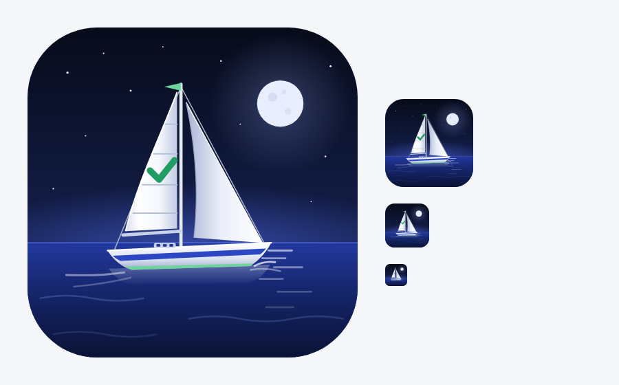

# Logo concepts

Every logo explored for Shipwright, kept for reference. The chosen mark, the ship's wheel (round 1, option A), is [`assets/logo.svg`](../logo.svg).

| Round | Concepts | Preview |
|---|---|---|
| Earlier | Hull with a check mark · Ship in a bottle (both with their banners) | [earlier/](earlier/) |
| 1 | **A · Ship's wheel (chosen)** · B · Anchor-check · C · Lighthouse |  |
| 2 | D · Compass · E · Porthole · F · Signal flags |  |
| 3 | G · Tall ship · H · Container ship · I · Shipyard · J · Paper boat |  |
| 4 | K · Sailboat at night (detailed illustration) |  |

All marks are hand-written SVG on a 160×160 tile (512×512 for round 4), using the project palette: navy, blue and a "pass" green.
