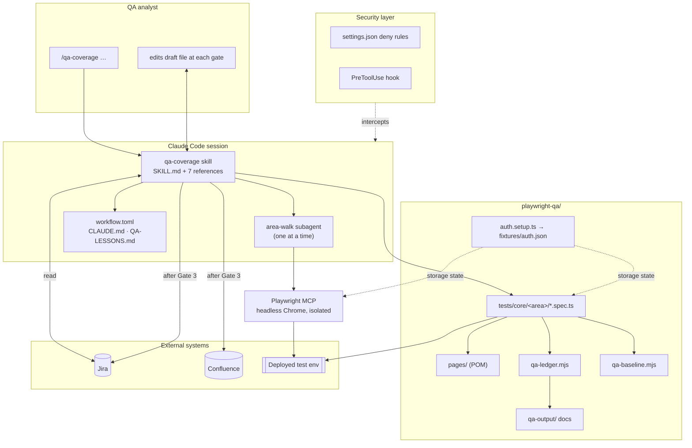
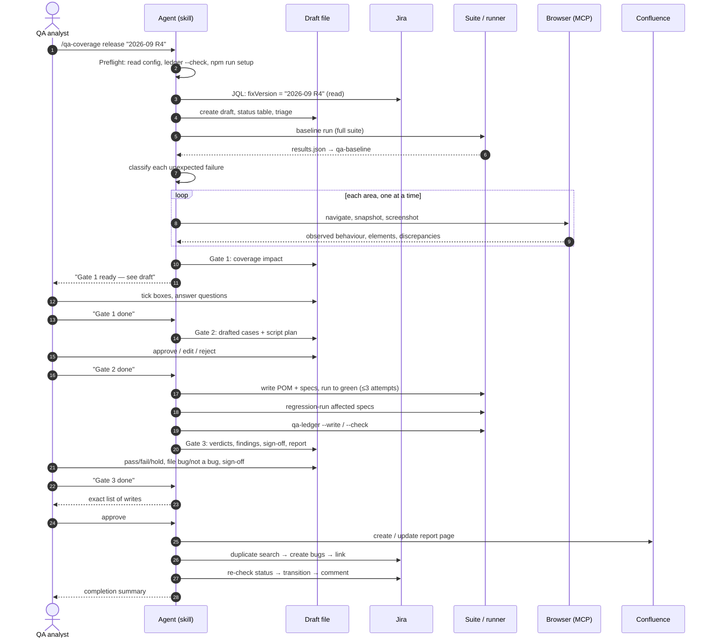

# Architecture

[← Back to README](../README.md)

Shipwright is built from five parts: an agent workflow (the skill), a Playwright suite, two small Node tools, a security layer, and the external systems it reads from and writes to. This page describes each part and how they interact.

## Component overview

## Components

### The skill: `.claude/skills/qa-coverage/`

`SKILL.md` holds the orchestration: the modes, the 13-step release flow, the non-negotiables, and the step-specific rules for exploring, writing and running to green. Detailed procedures live in reference files the agent loads **only at the step that needs them**, which keeps its working context small and focused:

| Reference | Loaded at | Contents |
|---|---|---|
| `intake-release.md` | Steps 1–2, 4 | JQL, triage buckets, grouping tickets by area, creating the draft |
| `intake-ticket.md` | Single-ticket mode, per-ticket | Extracting ACs, spec-synced tickets, git → route hints, "not found" handling |
| `intake-manual.md` | Manual mode | Questions to ask *before* opening the browser, deriving ACs from observation |
| `failure-classification.md` | Step 3, Step 9 | Baseline run, the class/evidence table, regression attribution |
| `templates.md` | Every gate | Draft-file layout, Gate 1/2/3 sections, report, evidence manifest, completion summary |
| `reconcile.md` | Step 10 | Generated vs hand-maintained docs, the triggers for each, evidence staging |
| `jira-actions.md` | Step 13 | Decision → action rules, bug filing, write order, comment templates, held tickets |

The skill's frontmatter sets `disable-model-invocation: true`, so it runs only when a human types the command. Its `allowed-tools` line pre-approves:

- reads
- edits **scoped to `/playwright-qa/**`**
- specific `git`, `npm run` and `npx playwright test` commands
- the Playwright MCP browser tools
- Jira and Confluence **read** tools only

### Configuration: `workflow.toml` + `CLAUDE.md`

Project facts live in two places:

- **`workflow.toml`** holds machine-readable values: Jira site, project key, the three QA status names, the priority map, the test URL, session lifetime, and the optional Confluence and feature-spec settings. The skill refers to them as placeholders such as `<jira.qa_status>`.
- **`playwright-qa/CLAUDE.md` → App map** holds judgement-level knowledge:
  - how source paths map to routes
  - which pages look alike but show different data
  - which controls store their state in the URL
  - UI library quirks
  - test roles

### Exploration: Playwright MCP

`.mcp.json` pins `@playwright/mcp@0.0.82` with these settings:

- installed Chrome
- `--isolated` profile
- `--headless`
- 1280×720 viewport
- `--storage-state` pointing at the suite's cached login, so the agent explores **as the QA user without ever seeing the credentials**

Each area walk is delegated to a subagent, one at a time, since there is only one browser. The subagent returns a fixed structure:

- routes walked
- per-ticket match or discrepancies
- element roles and names for locators
- domain data needed
- broken behaviour, with screenshots

### The suite: `playwright-qa/scripts/`

| File | Role |
|---|---|
| `playwright.config.ts` | `workers: 1`, `globalTimeout` 15 min, `list` + `html` + `json` reporters (the JSON one feeds `qa-baseline`), a `setup` project that the `chromium` project depends on |
| `tests/auth.setup.ts` | Signs in once and reuses `fixtures/auth.json` only while it's younger than `AUTH_REUSE_MINUTES` |
| `utils/auth.ts` | The login flow, using role/label locators |
| `pages/BasePage.ts` | `open(path, ready)`: navigate, then wait for an element that proves the page rendered |
| `pages/*.ts` | One class per page. Locators are readonly properties and actions are methods named for what the user does |
| `tests/core/<area>/*.spec.ts` | Specs with no selectors, each test carrying its ID docstring and ticket tags |

### Tools: `qa-ledger` and `qa-baseline`

Both are plain ES modules with no dependencies beyond Node itself.

**`qa-ledger`** is a static parser and generator. In order, it:

1. Scans `tests/**/*.spec.ts` with a declaration regex that matches `test(` and `test.skip|fail|fixme|only(` when the first argument is a string. This means a runtime `test.skip()` inside a test body isn't counted.
2. Reads the `/** … */` docstring directly above each declaration.
3. Collects `@TICKET` tags from the declaration up to the callback's `async`.
4. Adds not-automated cases from `### <ID>:` headings in `test-cases.md`.
5. Runs its checks: duplicate IDs, unrecognised IDs, docstring shape, and `Verifies:` lines.
6. Renders the generated outputs and compares them with the files on disk, after normalising line endings.

**`qa-baseline`** reads the last `results.json` and emits failures and flaky passes, with IDs and first error lines. It also flags a known bug as now passing when a test's `expectedStatus` is `failed` but it passed.

### Security layer

Covered in detail in the [README](../README.md#security-model). In short:

- **Deny rules** block the Read tool on credential files.
- **A Node `PreToolUse` hook** inspects every Bash and PowerShell command string (and the working directory) and exits `2` to block anything that references them.

## Sequence: a release run

## Sequence: Jira write ordering in step 13

The order matters: bugs come first because the comments and links need their keys, and every status is re-checked immediately before a transition.

```mermaid
flowchart LR
    A["Re-read Gate 3<br/>decisions"] --> B["Duplicate search<br/>per 'file bug'"]
    B --> C["Bug triage table<br/>→ analyst confirms"]
    C --> D["Check affects-version<br/>exists"]
    D --> E["Create bugs"]
    E --> F["Link: Blocks / Relates"]
    F --> G["Re-fetch each ticket's<br/>status"]
    G --> H["Build batch:<br/>transition + comment"]
    H --> I["Analyst approves"]
    I --> J["Transition by target<br/>status name"]
    J --> K["Comment with evidence"]
```

Some safety details in this step:

- **Transitions are chosen by target status name** (`to.name`), not by the transition's own label, which differs between workflows.
- **If no direct transition exists, the row is skipped and reported.** The agent never chains transitions.
- **A ticket that moved out of the QA status since intake is dropped from the batch** rather than being transitioned from an unexpected state.
- **Contradictions are queried.** If the analyst marks a ticket *pass* but also marks a blocking bug against it, the agent asks which one they meant.

## State and resumability

| State | Where | Lifetime |
|---|---|---|
| Run progress + every decision | `qa-output/drafts/<run-id>.md` | Until the run completes (gitignored) |
| Evidence screenshots | `qa-output/screenshots/<run-id>/` | Until attached by hand (gitignored) |
| Evidence manifest | `screenshots/<run-id>/to-attach/to-attach.md` | Until attached |
| Cached login | `scripts/fixtures/auth.json` | `AUTH_REUSE_MINUTES` (gitignored, unreadable by the agent) |
| Test inventory, ticket mapping | `qa-output/test-index.md`, `jira-test-mapping.md` | Permanent, generated |
| Lessons, known infra issues | `QA-LESSONS.md`, `KNOWN-ISSUES.md` | Permanent, hand-kept |

On start, the agent looks for an existing draft for the same run-id and offers to resume from the last gate passed.
